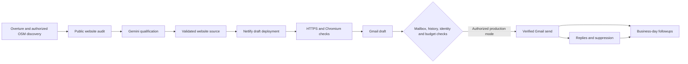

# UK Website Agent

A Python application for United Kingdom business discovery, evidence-based website qualification, safe website concept generation, verified HTTPS previews, and controlled Gmail outreach. PostgreSQL is the durable source of truth; GitHub Actions runs it while your laptop is off.

**Deployment status: the unified Python implementation is merged into main and one GitHub Actions workflow remains.** One-click manual dispatch and two India-time slots are configured; actual account/database/preview/email verification is still outstanding. Existing GitHub Secrets remain in GitHub without local copying. No confirmed live prospect emails or Netlify deployments are claimed.

## Start here

1. Follow [SETUP_GUIDE.md](SETUP_GUIDE.md) for secrets, OAuth, provider authorization, and database setup.
2. Follow [DEPLOYMENT_GUIDE.md](DEPLOYMENT_GUIDE.md) for hosting, schedules, manual runs, and production activation.
3. Read [docs/ARCHITECTURE.md](docs/ARCHITECTURE.md), [SECURITY.md](SECURITY.md), and [docs/LIMITATIONS.md](docs/LIMITATIONS.md).
4. Read [docs/FINAL_READINESS.md](docs/FINAL_READINESS.md) for current evidence and one owner-action checklist; [docs/HANDOVER.md](docs/HANDOVER.md) retains the historical handover.
5. Read [docs/EMAIL_SENDING.md](docs/EMAIL_SENDING.md) for owner-managed automatic salon outreach and the optional reviewed-record mode, then verify actual sends in the run summary.

```bash
python -m pip install uv==0.11.16
uv sync --frozen --extra dev
uv run playwright install chromium
uv run pytest
uv run website-agent doctor
# Production changes require separate owner approval; use the reviewed Actions diagnostics first.
```

`doctor` lists missing setting names without displaying secret values. `doctor --live` reads external account metadata but persists model-check state in the database. The production workflow now exposes one-click daily operation, not the former diagnostics form. Read-only diagnostics remain available through the documented CLI and authorized account access; review [one-click prerequisites](docs/UNIFIED_WORKFLOW.md) before running. `live-smoke` performs explicit generation, deployment, browser checks, and a Gmail draft addressed to the owner; it never sends email. Mock tests never call live commercial APIs.

## Unified operations and Gemini fallback

Use **Actions → UK Website Agent → Run workflow → Run workflow** on main. There are **no input boxes**: owner dispatch searches exclusively in the United Kingdom (GB) and starts one daily pipeline invocation. Twice-daily UTC schedules are `30 9 * * *` and `30 15 * * *` (3 PM / 9 PM IST). Automatic schedules are now enabled in code for both India-time slots, subject to GitHub Actions' scheduling delays and available provider capacity. See the [one-click control guide](docs/UNIFIED_WORKFLOW.md). No workflow automatically migrates the database.

[Gemini fallback](docs/GEMINI_FALLBACK.md) selects owner-reviewed Free-Tier models with bounded cooldowns and token checks. Quota review expires November 21, 2026; at most 12 AI requests/day and paid fallback remains disabled. Owner manual runs and both schedules enable Gemini generation, Netlify preview, Gmail drafts and initial sending. The workflow uses `OUTREACH_POLICY_MODE=operator_managed`: the owner manages legal/provider obligations outside the application, without invented consent or legal-review records. Only observed same-domain public role mailboxes are eligible, with suppression, sender identity, fresh preview verification and Gmail history checks. At most one new email per run and two per day; automatic followups/replies stay disabled. A green Actions result alone does not prove deployment or sending.

## Zero-key discovery

The default `open_data` mode uses Overture Maps with licensed OSM fallback, bounded geographic/category expansion, persistent recovery and deterministic website verification. It uses official STAC geographic asset selection and bounded Parquet ranges, with no discovery API key. OSM is implemented but remains disabled until licensed extract/endpoint setup. Run `uv run website-agent discover --country US` for discovery only after database setup. It never initializes Gemini, Netlify or Gmail. Read [discovery setup, limits and recovery](docs/DISCOVERY.md) and the [current live readiness report](docs/LIVE_READINESS_REPORT.md) before a live run. Public Overture reads succeeded. All 12 required GitHub Secret names are present; persistent discovery and account checks await the owner's [manual diagnostics review and launch](docs/MANUAL_LIVE_VERIFICATION.md). No local credential copy is required.

## Implemented flow



The application includes all fourteen requested persistent tables, immutable migration SQL, global capacity controls, database locks, deterministic email identifiers, reply classification, imported history/suppressions, resumable hosting steps, bounded AI requests, and job-summary reporting.

Production configuration targets **10 UK cities**, **salons/parlors only**, and **one country code: GB**. Older non-UK or other-category leads remain in Supabase but are excluded from daily processing. Business candidates come from public discovery sources; Gemini qualifies observed website evidence and creates the design, never guesses recipient addresses. See the email guide for legal/provider limits; this configuration is not a compliance certification.

All package versions and distribution hashes are pinned by `uv.lock`. Use `uv sync --frozen`; `pyproject.toml` specifies update compatibility ranges, not the deployed resolution. Tests and development tools remain available locally; no separate testing workflow exists.

## Default global limits

| Setting | Default |
|---|---:|
| Businesses discovered per run | 3 |
| Websites inspected per run | 3 |
| Qualified businesses selected per run | 1 |
| New previews per UTC day | 2 |
| New outreach/acknowledgment sends per UTC day | 2 |
| Followup sends per UTC day | 0 |
| Followups per prospect | 0 |
| Minimum time between outreach steps | 5 local business days |
| Qualification score | below 55 / 100 |
| Gemini request attempts per UTC day | 12 |
| Configured Gemini daily budget | USD 1.00 |

No universal free-tier claim is made. Provider contracts, Gmail/Actions limits, hosting retention, model access, and account-specific quotas require verification. There are no purchase, billing activation, or account-management actions in the application.
