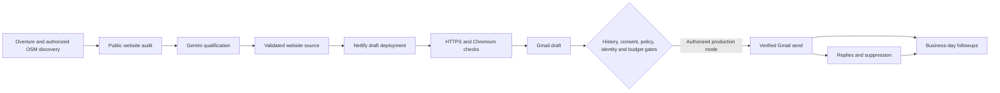

# Global Website Agent

A Python application for global business discovery, evidence-based website qualification, safe website concept generation, verified HTTPS previews, and controlled Gmail outreach. PostgreSQL is the durable source of truth; GitHub Actions runs it while your laptop is off.

**Deployment status: public AWS/Azure discovery reads and offline safeguards verified; credentialed integrations await owner-approved diagnostics.** The existing 12 GitHub Secrets are reused without local copying. Unified workflow registration PR #8 is merged; feature PR #6 remains open. The feature consolidates seven definitions into one control panel; main retains legacy definitions until the implementation is separately merged. No business emails have been sent, no paid services enabled, and the existing Base44 system has not been accessed or changed.

## Start here

1. Follow [SETUP_GUIDE.md](SETUP_GUIDE.md) for secrets, OAuth, provider authorization, and database setup.
2. Follow [DEPLOYMENT_GUIDE.md](DEPLOYMENT_GUIDE.md) for hosting, schedules, manual runs, and production activation.
3. Read [docs/ARCHITECTURE.md](docs/ARCHITECTURE.md), [SECURITY.md](SECURITY.md), and [docs/LIMITATIONS.md](docs/LIMITATIONS.md).
4. Read [docs/FINAL_READINESS.md](docs/FINAL_READINESS.md) for current evidence and one owner-action checklist; [docs/HANDOVER.md](docs/HANDOVER.md) retains the historical handover.

```bash
python -m pip install uv==0.11.16
uv sync --frozen --extra dev
uv run playwright install chromium
uv run pytest
uv run website-agent doctor
# Production changes require separate owner approval; use the reviewed Actions diagnostics first.
```

`doctor` lists missing setting names without displaying secret values. `doctor --live` reads external account metadata but persists model-check state in the database. For strictly read-only database diagnostics using existing GitHub Secrets, follow [manual live verification](docs/MANUAL_LIVE_VERIFICATION.md). `live-smoke` performs explicit generation, deployment, browser checks, and a Gmail draft addressed to the owner; it never sends email. Mock tests never call live commercial APIs.

## Unified operations and Gemini fallback

Use **Actions → Global Website Agent → Run workflow** after reviewing the current feature SHA. Modes: diagnostics, discover, daily, replies, followups, report, reconcile and live-smoke. Schedules retain the four original UTC cadences and remain disabled. Read [control-panel approvals](docs/UNIFIED_WORKFLOW.md) and [migration order](docs/WORKFLOW_MIGRATION.md). No workflow automatically migrates the database.

[Gemini fallback](docs/GEMINI_FALLBACK.md) selects only reviewed exact models, checks account metadata/token limits, honors persistent quota pauses and retains provenance. Generation, deployment and draft creation now default disabled independently of sending. Account usage authorizations/prices remain empty; no free eligibility is invented. The default candidate order is 3.8 Flash → 3.6 Flash → 3.5 Flash-Lite → eligible 2.5 Flash/Flash-Lite; 3.7 aliases 3.8 and is not an independent fallback.

## Zero-key discovery

The default `open_data` mode uses Overture Maps with licensed OSM fallback, bounded geographic/category expansion, persistent recovery and deterministic website verification. It uses official STAC geographic asset selection and bounded Parquet ranges, with no discovery API key. OSM is implemented but remains disabled until licensed extract/endpoint setup. Run `uv run website-agent discover --country US` for discovery only after database setup. It never initializes Gemini, Netlify or Gmail. Read [discovery setup, limits and recovery](docs/DISCOVERY.md) and the [current live readiness report](docs/LIVE_READINESS_REPORT.md) before a live run. Public Overture reads succeeded. All 12 required GitHub Secret names are present; persistent discovery and account checks await the owner's [manual diagnostics review and launch](docs/MANUAL_LIVE_VERIFICATION.md). No local credential copy is required.

## Implemented flow



The application includes all fourteen requested persistent tables, immutable migration SQL, global capacity controls, database locks, deterministic email identifiers, reply classification, imported history/suppressions, resumable hosting steps, bounded AI requests, and job-summary reporting.

Configuration ships with eleven countries and twelve niches. Countries, cities, languages, time zones, search strings, daily budgets, and eligibility policies are configured in YAML. New countries require a supported holiday calendar and a reviewed sending policy; otherwise sends remain blocked.

All package versions and distribution hashes are pinned by `uv.lock`. Use `uv sync --frozen`; `pyproject.toml` specifies update compatibility ranges, not the deployed resolution. Tests and development tools remain available locally; automated test, lint and dependency-audit workflows have been removed.

## Default global limits

| Setting | Default |
|---|---:|
| Businesses discovered per run | 30 |
| Websites inspected per run | 10 |
| Qualified businesses selected per run | 5 |
| New previews per UTC day | 2 |
| New outreach/acknowledgment sends per UTC day | 2 |
| Followup sends per UTC day | 2 |
| Followups per prospect | 2 |
| Minimum time between outreach steps | 5 local business days |
| Qualification score | below 55 / 100 |
| Gemini request attempts per UTC day | 30 |
| Configured Gemini daily budget | USD 1.00 |

No universal free-tier claim is made. Provider contracts, Gmail/Actions limits, hosting retention, model access, and account-specific quotas require verification. There are no purchase, billing activation, or account-management actions in the application.
